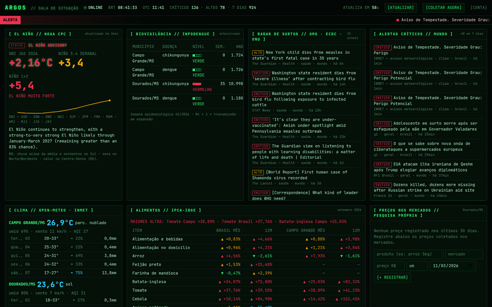
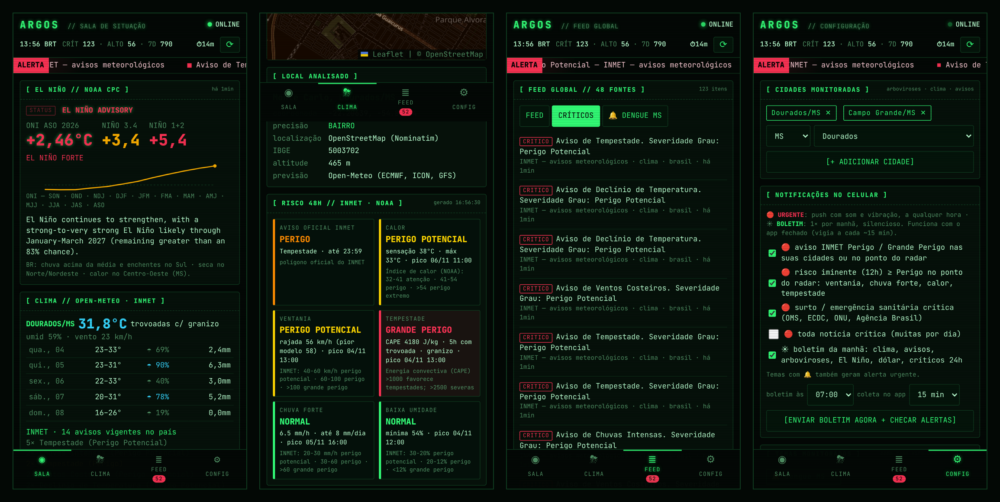

<div align="center">


# ARGOS

**Os cem olhos sobre o Brasil e o mundo — monitoramento ativo via MCP e sala de situação em tempo real**

_Baseado no projeto open-source [mcp-brasil](https://github.com/jxnxts/mcp-brasil). O pacote Python continua se chamando `mcp_brasil`._


[](https://opensource.org/licenses/MIT)

403 tools · 49 integrações · 48 feeds de notícias (Brasil e mundo) · El Niño (NOAA) · biovigilância · alimentos · sala de situação · Metabase · planos com Mercado Pago

Conecte AI agents (Claude, GPT, Copilot, etc.) a dados governamentais do Brasil — economia, legislação, transparência, judiciário, eleições, meio ambiente, saúde, segurança pública e mais.

**38 APIs não requerem chave** · 3 usam chaves gratuitas (cadastro em 1 min)

[Quick Start](#quick-start) · [Sala de situação](#sala-de-situação) · [Modo comercial](#radar-brasil-modo-comercial) · [Fontes de dados](#fontes-de-dados) · [Documentação](#documentação) · [Desenvolvimento](#desenvolvimento)

</div>

---

## Sala de situação

`/painel` é uma tela em tempo real, com visual de terminal, que reúne:

- **El Niño**, pelo alerta oficial da NOAA (ONI e Niño 3.4 semanal);
- **biovigilância**: dengue, zika e chikungunya por município, mais um radar de surtos e pandemias;
- **alimentos**: IPCA da cesta e pesquisa própria de preços em Dourados ou outra cidade;
- **clima**, com avisos do INMET;
- **câmbio**, **terremotos** e **alertas críticos** do mundo inteiro;
- **feed de notícias** com temas e filtros configurados por cada usuário;
- **radar climático local** (`/clima`): calor, ventania, tempestade e chuva por **bairro ou ponto no mapa**, com polígonos oficiais do INMET, METAR e 3 modelos ([guia](docs/deploy/radar-climatico-local.md));
- **alertas no WhatsApp (Evolution API) e no Telegram**, com um resumo por rodada e só quando há novidade ([guia](docs/deploy/alertas-whatsapp-telegram.md)).



Um coletor grava tudo em `indicadores.db`, e o **Metabase** lê esse banco para os relatórios.
Veja [docs/deploy/argos-sala-de-situacao.md](docs/deploy/argos-sala-de-situacao.md).

## App Android (roda no celular)



O app tem o mesmo visual da sala de situação e **coleta tudo direto do celular, sem servidor**.
São quatro telas:

- **SALA:** El Niño, clima, avisos do INMET, arboviroses, surtos, IPCA, preços, câmbio e sismos;
- **CLIMA:** radar por município e bairro, com mapa e riscos em 48 h;
- **FEED:** 48 fontes de notícias, com temas;
- **CONFIG:** cidades, temas e preferências de alerta.

Com o app fechado, um vigia em segundo plano envia **alertas urgentes** como push e o **boletim da manhã**.

- **Baixar:** [`mobile/releases/argos-ultima.apk`](mobile/releases/argos-ultima.apk) (versão 1.0.0, Android 7 ou superior)
- **Instalação, permissões e política de alertas:** [`docs/mobile/ANDROID.md`](docs/mobile/ANDROID.md)
- **Licença:** © 2026 VSA Soluções em Tecnologia. Os componentes ARGOS são proprietários
  ([`LICENCA-ARGOS.md`](LICENCA-ARGOS.md)); o código de origem mcp-brasil continua MIT ([`LICENSE`](LICENSE)).

## Radar Brasil (modo comercial)

Com `MCP_BRASIL_AUTH_MODE=radar`, o servidor vira um produto pago:

- **Portal do cliente** em `/conta`, com cadastro, login, contratação de plano, chaves de API e pagamentos
- **Chave de API por cliente** (`Authorization: Bearer rb_...`), válida só enquanto o plano estiver pago
- **Planos com limite diário de consultas**: Essencial, Profissional e Empresarial, configuráveis
- **Mercado Pago**: assinatura mensal no cartão ou 30 dias avulsos com Pix ou boleto, liberação automática por webhook validado (`x-signature`) e corte de acesso em caso de estorno
- **Administração** no portal e pela linha de comando (`python -m mcp_brasil.radar`)

```bash
MCP_BRASIL_AUTH_MODE=radar
MCP_BRASIL_BASE_URL=https://radar.seudominio.com.br
RADAR_SECRET_KEY=...
MERCADOPAGO_ACCESS_TOKEN=APP_USR-...
MERCADOPAGO_WEBHOOK_SECRET=...
```

Passo a passo completo: [docs/deploy/radar-brasil.md](docs/deploy/radar-brasil.md).

## Features

- **363 tools** em 41 features cobrindo 11 áreas — economia, legislativo, transparência, judiciário, eleitoral, ambiental, saúde, segurança pública, compras públicas, utilidades e mais
- **Cross-referencing** com `planejar_consulta` — cria planos de execução combinando múltiplas APIs (ex: gastos de um deputado + votações + proposições)
- **Execução em lote** com `executar_lote` — dispara consultas em paralelo numa única chamada
- **Smart discovery** — BM25 search transform filtra 363 tools para só mostrar as relevantes ao contexto
- **Auto-registry** — adicionar uma feature é criar uma pasta; zero configuração manual
- **Async everywhere** — httpx async + Pydantic v2 + rate limiting com backoff

## Subir em VPS (produção)

Uma VPS Ubuntu com **1 vCPU e 1 GB de RAM** basta: o ARGOS usa ~200 MB e roda em um único container mais o Caddy (HTTPS).

```bash
git clone https://github.com/viniciusandradde/mcp-brasil.git /opt/argos && cd /opt/argos
bash scripts/instalar_vps.sh --dominio argos.seudominio.com.br --email voce@seudominio.com.br
```

Passo a passo completo (e roteiro para o Claude instalar sozinho): [docs/deploy/HANDOFF_VPS.md](docs/deploy/HANDOFF_VPS.md).

## Quick Start

### Instalar

```bash
pip install mcp-brasil
```

```bash
uv add mcp-brasil
```

### Claude Desktop

Adicione ao `claude_desktop_config.json`:

```json
{
  "mcpServers": {
    "mcp-brasil": {
      "command": "uvx",
      "args": ["--from", "mcp-brasil", "python", "-m", "mcp_brasil.server"],
      "env": {
        "TRANSPARENCIA_API_KEY": "sua-chave-aqui",
        "DATAJUD_API_KEY": "sua-chave-aqui",
        "META_ACCESS_TOKEN": "seu-token-aqui"
      }
    }
  }
}
```

> As chaves são opcionais — sem elas, as 36 APIs restantes funcionam normalmente.

### VS Code / Cursor

Crie `.vscode/mcp.json` na raiz do projeto:

```json
{
  "servers": {
    "mcp-brasil": {
      "command": "uvx",
      "args": ["--from", "mcp-brasil", "python", "-m", "mcp_brasil.server"],
      "env": {
        "TRANSPARENCIA_API_KEY": "sua-chave-aqui",
        "DATAJUD_API_KEY": "sua-chave-aqui",
        "META_ACCESS_TOKEN": "seu-token-aqui"
      }
    }
  }
}
```

### Claude Code

```bash
claude mcp add mcp-brasil -- uvx --from mcp-brasil python -m mcp_brasil.server
```

### HTTP (outros clientes)

```bash
fastmcp run mcp_brasil.server:mcp --transport http --port 8000
# Server disponível em http://localhost:8000/mcp
```

## Exemplos

Conecte o server e faça perguntas em linguagem natural:

> **Legislativo:** "Quais projetos de lei sobre inteligência artificial tramitaram na Câmara em 2024? Quem foram os autores?"

> **Econômico:** "Qual a tendência da taxa Selic nos últimos 12 meses? Compare com a inflação (IPCA) no mesmo período."

> **Transparência:** "Quais os 10 maiores contratos do governo federal em 2024? Quem são os fornecedores?"

> **Cross-reference:** "Compare os gastos per capita com saúde em São Paulo e Minas Gerais cruzando dados do TCE-SP e IBGE."

> **Judiciário:** "Busque processos sobre licitação irregular no TCU. Quais foram as penalidades aplicadas?"

> **Eleitoral:** "Quais os maiores doadores da campanha do candidato X? Qual o total arrecadado?"

## Fontes de dados

### Economia e Finanças

| Feature | Fonte | Tools |
|---------|-------|:-----:|
| `bacen` | Banco Central — Selic, IPCA, câmbio, PIB e +190 séries temporais | 9 |
| `bndes` | BNDES — operações de financiamento, desembolsos, instituições credenciadas | 4 |
| `siconfi` | Tesouro Nacional (SICONFI) — RREO, RGF/LRF, DCA (arrecadação de impostos) de União, estados e municípios | 5 |

### Geografia e Estatística

| Feature | Fonte | Tools |
|---------|-------|:-----:|
| `ibge` | IBGE — estados, municípios, nomes, agregados estatísticos | 9 |

### Legislativo e Legislação

| Feature | Fonte | Tools |
|---------|-------|:-----:|
| `camara` | Câmara dos Deputados — deputados, proposições, votações, despesas | 11 |
| `senado` | Senado Federal — senadores, matérias, votações, comissões | 26 |
| `lexml` | LexML Brasil — leis, decretos, MPs e projetos de todas as esferas | 3 |

### Notícias (Brasil e mundo)

| Feature | Fonte | Tools |
|---------|-------|:-----:|
| `noticias` | 48 feeds: Agência Brasil, Câmara, Senado, Planalto, BC, INMET, g1, CNN Brasil, OMS, ECDC, ONU, BBC, Guardian, NYT, DW, RFI, Al Jazeera, Fed, BCE, ReliefWeb, USGS — com criticidade | 4 |

### Clima, desastres e saúde global

| Feature | Fonte | Tools |
|---------|-------|:-----:|
| `clima` | El Niño/La Niña (NOAA CPC), previsão e qualidade do ar (Open-Meteo), avisos INMET, terremotos (USGS), eventos naturais (NASA EONET) | 6 |
| `vigilancia` | Dengue, chikungunya e zika por município (InfoDengue) e radar de surtos | 2 |
| `alimentos` | Inflação dos alimentos da cesta — IPCA/IBGE, Brasil e 16 capitais | 2 |
| `mundo` | Câmbio (BCE/Frankfurter) e indicadores do Banco Mundial | 3 |

### Transparência e Fiscalização

| Feature | Fonte | Tools |
|---------|-------|:-----:|
| `transparencia` | Portal da Transparência — contratos, despesas, servidores, sanções, imóveis funcionais, renúncias fiscais, órgãos, COVID-19 | 54 |
| `tcu` | Tribunal de Contas da União — acórdãos, inidôneos, débitos, pautas | 9 |
| `tce_sp` | TCE-SP — despesas e receitas de 645 municípios paulistas | 3 |
| `tce_rj` | TCE-RJ — licitações, contratos, obras, penalidades, concessões | 7 |
| `tce_rs` | TCE-RS — educação, saúde, gestão fiscal (LRF) | 5 |
| `tce_pe` | TCE-PE — licitações, contratos, despesas, fornecedores | 5 |
| `tce_ce` | TCE-CE — licitações, contratos, empenhos | 4 |
| `tce_es` | TCE-ES — licitações, contratos, obras públicas | 4 |
| `tce_rn` | TCE-RN — jurisdicionados, licitações, contratos | 5 |
| `tce_pi` | TCE-PI — prefeituras, despesas, receitas | 5 |
| `tce_sc` | TCE-SC — municípios e unidades gestoras | 2 |
| `tce_to` | TCE-TO — processos, pautas de sessões | 3 |

### Judiciário

| Feature | Fonte | Tools |
|---------|-------|:-----:|
| `datajud` | DataJud/CNJ — processos judiciais, movimentações | 7 |
| `jurisprudencia` | STF, STJ e TST — acórdãos, súmulas, decisões | 6 |

### Eleitoral

| Feature | Fonte | Tools |
|---------|-------|:-----:|
| `tse` | TSE — eleições, candidatos, prestação de contas | 15 |
| `anuncios_eleitorais` | Biblioteca de Anúncios da Meta — propaganda eleitoral na internet | 6 |

### Meio Ambiente

| Feature | Fonte | Tools |
|---------|-------|:-----:|
| `inpe` | INPE — focos de queimadas, desmatamento DETER/PRODES | 4 |
| `ana` | ANA — estações hidrológicas, telemetria, reservatórios | 3 |

### Saúde

| Feature | Fonte | Tools |
|---------|-------|:-----:|
| `saude` | CNES/DataSUS — estabelecimentos, profissionais, leitos | 10 |
| `opendatasus` | OpenDataSUS — datasets de saúde pública (CKAN) | 7 |
| `anvisa` | ANVISA — bulário, medicamentos, preços CMED, registros | 10 |
| `denasus` | DENASUS — auditorias do SUS | 5 |
| `imunizacao` | SI-PNI — vacinação, calendário, cobertura vacinal, SRAG | 10 |
| `bps` | BPS — preços de medicamentos e dispositivos médicos no SUS | 3 |
| `farmacia_popular` | Farmácia Popular — medicamentos gratuitos, farmácias credenciadas | 8 |
| `rename` | RENAME — medicamentos essenciais do SUS por princípio ativo | 5 |

### Segurança Pública

| Feature | Fonte | Tools |
|---------|-------|:-----:|
| `atlas_violencia` | Atlas da Violência (IPEA/FBSP) — homicídios, violência por gênero/raça, armas de fogo | 7 |
| `sinesp` | SINESP/MJSP — datasets de segurança pública, sistema penitenciário | 6 |
| `forum_seguranca` | Fórum Brasileiro de Segurança Pública — publicações, Anuário | 4 |

### Compras Públicas

| Feature | Fonte | Tools |
|---------|-------|:-----:|
| `compras` | PNCP + ComprasNet/SIASG — licitações, contratos, pregões, CATMAT | 29 |
| `transferegov` | TransfereGov — emendas parlamentares PIX | 5 |

### Dados Abertos e Utilidades

| Feature | Fonte | Tools |
|---------|-------|:-----:|
| `brasilapi` | BrasilAPI — CEP, CNPJ, DDD, bancos, câmbio, FIPE, PIX | 16 |
| `dados_abertos` | Dados Abertos (dados.gov.br) — catálogo de datasets federais | 4 |
| `diario_oficial` | Querido Diário + DOU — diários oficiais de 5.000+ cidades e da União | 11 |
| `tabua_mares` | Tábua de Marés — previsão de marés para portos do litoral | 7 |

> O server raiz também expõe 4 meta-tools: `listar_features`, `recomendar_tools`, `planejar_consulta` e `executar_lote`.

## Chaves de API

| API | Obrigatória? | Como obter |
|-----|-------------|------------|
| Portal da Transparência | Opcional | [Cadastro gratuito](https://portaldatransparencia.gov.br/api-de-dados/cadastrar-email) |
| DataJud/CNJ | Opcional | [Cadastro gratuito](https://datajud-wiki.cnj.jus.br/api-publica/acesso) |
| Anúncios Eleitorais (Meta) | Opcional | [Meta Ad Library API](https://www.facebook.com/ads/library/api/) |
| Todas as outras (36) | Nenhuma chave | — |

Configure via variáveis de ambiente ou `.env`:

```bash
TRANSPARENCIA_API_KEY=sua-chave
DATAJUD_API_KEY=sua-chave
META_ACCESS_TOKEN=seu-token
```

## Configuração

| Variável | Default | Descrição |
|----------|---------|-----------|
| `TRANSPARENCIA_API_KEY` | — | Chave do Portal da Transparência |
| `DATAJUD_API_KEY` | — | Chave do DataJud/CNJ |
| `META_ACCESS_TOKEN` | — | Token da [Meta Ad Library API](https://www.facebook.com/ads/library/api/) |
| `MCP_BRASIL_AUTH_MODE` | auto | `none`, `static`, `oauth`, `multi` ou `radar` (modo comercial) |
| `MERCADOPAGO_ACCESS_TOKEN` | — | Access Token do Mercado Pago (modo `radar`) |
| `MERCADOPAGO_WEBHOOK_SECRET` | — | Assinatura secreta dos webhooks do Mercado Pago (modo `radar`) |
| `RADAR_SECRET_KEY` | — | Chave que assina as sessões do portal (modo `radar`) |
| `RADAR_DB_PATH` | `data/radar.db` | Banco SQLite de usuários, chaves e pagamentos (modo `radar`) |
| `MCP_BRASIL_TOOL_SEARCH` | `bm25` | Modo de discovery: `bm25`, `code_mode` ou `none` |
| `MCP_BRASIL_HTTP_TIMEOUT` | `30.0` | Timeout HTTP em segundos |
| `MCP_BRASIL_HTTP_MAX_RETRIES` | `3` | Máximo de retentativas HTTP |

## Documentação

| Página | Descrição |
|--------|-----------|
| [Quick Start](docs/guide/quickstart.md) | Instalação e configuração em 2 minutos |
| [Arquitetura](docs/concepts/architecture.md) | Como o projeto funciona por dentro |
| [Catálogo de Features](docs/reference/features.md) | Todas as 41 features e 363 tools |
| [Smart Tools](docs/reference/smart-tools.md) | Meta-tools: planner, batch, discovery |
| [Adicionando Features](docs/guide/adding-features.md) | Guia para contribuir com novas APIs |
| [Configuração](docs/reference/configuration.md) | Variáveis de ambiente e opções |
| [Radar Brasil](docs/deploy/radar-brasil.md) | Vender acesso: planos, chaves por cliente, Mercado Pago |
| [Sala de situação e Metabase](docs/deploy/argos-sala-de-situacao.md) | Painel em tempo real, coletor, temas, preços, relatórios |
| [Radar climático local](docs/deploy/radar-climatico-local.md) | Riscos climáticos por bairro, fontes e critérios |
| [Alertas WhatsApp e Telegram](docs/deploy/alertas-whatsapp-telegram.md) | Bot do Telegram e WhatsApp via Evolution API (Meta oficial na próxima versão) |
| [Meta Ad Library API](docs/reference/meta-ad-library-api.md) | Referência da API de anúncios eleitorais da Meta |
| [Code Mode](docs/reference/code-mode.md) | Discovery programático + sandbox Python (experimental) |
| [Desenvolvimento](docs/guide/development.md) | Setup de dev, testes, lint, CI |

## Desenvolvimento

```bash
git clone https://github.com/jxnxts/mcp-brasil.git
cd mcp-brasil
make dev              # Instalar dependências (prod + dev)
make test             # Rodar todos os testes
make test-feature F=ibge  # Testes de uma feature
make lint             # Lint + format check
make ruff             # Auto-fix lint + format
make types            # mypy strict
make ci               # lint + types + test
make run              # Server stdio
make serve            # Server HTTP :8000
make inspect          # Listar tools/resources/prompts
```

## Arquitetura

O projeto usa **Package by Feature** com **Auto-Registry** — cada feature é uma pasta auto-contida:

```
src/mcp_brasil/
├── server.py              # Auto-registry (nunca editado manualmente)
├── _shared/               # Utilitários compartilhados
├── data/                  # 45 features de consulta a APIs
│   ├── ibge/
│   │   ├── __init__.py    # FEATURE_META
│   │   ├── server.py      # FastMCP instance
│   │   ├── tools.py       # Lógica das tools
│   │   ├── client.py      # HTTP async
│   │   ├── schemas.py     # Pydantic models
│   │   └── constants.py   # URLs, códigos
│   ├── bacen/
│   └── ...
├── agentes/               # Features de agentes inteligentes
│   └── redator/
└── radar/                 # ARGOS: usuários, planos, Mercado Pago, portal, painel, coletor
```

Para adicionar uma nova feature, basta criar o diretório seguindo a convenção — o registry descobre automaticamente.

## Contribuindo

1. Fork o repositório
2. Crie uma feature em `src/mcp_brasil/data/{feature}/` ou `agentes/{feature}/`
3. Exporte `FEATURE_META` no `__init__.py` e `mcp: FastMCP` no `server.py`
4. Adicione testes em `tests/data/{feature}/`
5. Rode `make ci` e abra um PR

## Disclaimer

Este projeto integra um número significativo de APIs governamentais brasileiras, muitas com documentação inconsistente ou incompleta. Embora todo esforço tenha sido feito para garantir precisão, alguns endpoints podem retornar resultados inesperados ou ter cobertura parcial de parâmetros.

Este é um projeto open-source da comunidade — se encontrar algo quebrado ou que possa ser melhorado, **abra uma issue ou envie um PR**. O objetivo é tornar dados públicos brasileiros acessíveis via IA, juntos.

Todos os dados vêm de APIs oficiais do governo brasileiro — o server não gera, modifica ou editorializa nenhum dado.

## Licença

MIT
