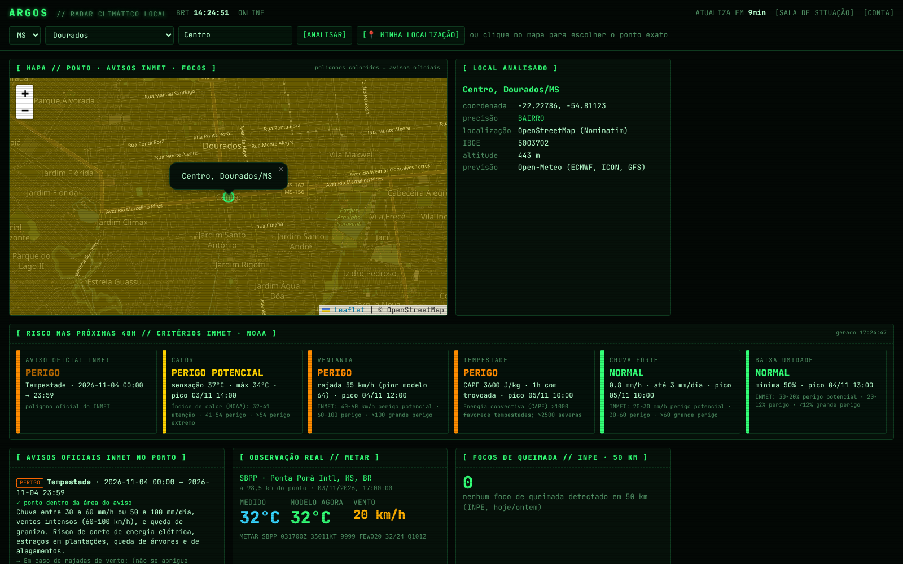

# ARGOS — radar climático local (`/clima`)

Painel exclusivo para riscos climáticos: **calor, ventania, tempestade, chuva forte e baixa umidade**
no nível do **bairro** ou de um **ponto exato**, escolhido por clique no mapa ou pelo GPS do aparelho.
Fica disponível para assinantes ativos, ao lado da sala de situação geral (`/painel`).

## Como escolher o local

1. **UF → município**: lista oficial do IBGE (5.571 municípios).
2. **Bairro** (opcional): digite ou escolha da lista. A lista vem do OpenStreetMap via Overpass; quando
   o bairro não está mapeado, a busca tenta o Nominatim e depois o Photon.
3. **Ponto exato**: clique no mapa ou use **📍 Minha localização**. É a opção mais precisa.

O painel mostra sempre a coordenada usada e o nível de precisão: `ponto`, `bairro`, `rua` ou
`municipio`, quando o bairro não foi encontrado e o centro da cidade foi usado.

## Fontes (as mais confiáveis disponíveis sem custo)

| Camada | Fonte | Precisão espacial | Atualização |
|---|---|---|---|
| Avisos oficiais | INMET (`/avisos/ativos`) | **Polígono exato do aviso**: testamos se o ponto está dentro | minutos |
| Observação real | METAR (NOAA Aviation Weather Center) | Aeroporto mais próximo (distância informada) | horária |
| Previsão 48h | ECMWF IFS (~9 km), DWD ICON (~13 km), NOAA GFS (~13-25 km) via Open-Meteo | Grade do modelo, interpolada para o ponto | horária |
| Incerteza | Consenso entre os 3 modelos | Divergência de Tmáx, rajada e chuva por dia | horária |
| Queimadas | INPE / BDQueimadas | Foco por satélite (~1 km), raio de 50 km | diária + 10 min |
| Bairros | OpenStreetMap (Nominatim, Photon, Overpass) | Centroide do bairro | contínua |

### Sobre "precisão milimétrica"

Nenhuma fonte meteorológica tem precisão de metros. O que o ARGOS faz para chegar o mais perto possível:

- **Avisos:** usa o polígono oficial do INMET, não só o nome do município. Um bairro na borda de
  um aviso aparece corretamente como dentro ou fora.
- **Previsão:** é calculada para a coordenada exata, mas os modelos têm resolução de 9 a 25 km.
  Bairros vizinhos recebem valores parecidos. Por isso o painel mostra a divergência entre modelos.
- **Observação:** é uma medição real, mas vem do aeroporto mais próximo, e a distância é exibida.
  Em Dourados, hoje, é Ponta Porã (98 km), porque o aeroporto local não transmite METAR.

Para chegar à escala de bairro de verdade, o caminho é instalar estações meteorológicas próprias
ou integrar redes locais, como as da Defesa Civil e de universidades. Fica como evolução futura.

## Critérios de risco (próximas 48 horas)

| Risco | Perigo Potencial | Perigo | Grande Perigo | Base |
|---|---|---|---|---|
| Ventania (rajada) | 40-60 km/h | 60-100 km/h | > 100 km/h | INMET |
| Chuva | 20-30 mm/h ou ≥ 30 mm/dia | 30-60 mm/h ou 50-100 mm/dia | > 60 mm/h ou > 100 mm/dia | INMET |
| Baixa umidade | 30-20 % | 20-12 % | < 12 % | INMET |
| Calor (sensação) | 32-41 °C (ou máx ≥ 35 °C) | 41-54 °C | > 54 °C | Índice de calor NOAA |
| Tempestade | CAPE ≥ 1000 ou trovoada prevista | CAPE ≥ 2500, ou trovoada com CAPE ≥ 1500 | granizo com CAPE ≥ 2500 | Convecção |

Para ventania e chuva, vale o **pior caso entre os modelos**: se um deles prevê rajada de 64 km/h,
o risco sobe para Perigo mesmo que a média seja menor. O card **Aviso oficial INMET** mostra à parte
a maior severidade dos avisos que cobrem o ponto.

## API e ferramenta MCP

- `GET /api/clima/local?uf=MS&cidade=Dourados&bairro=Centro` ou `?lat=-22.2286&lon=-54.8203&cidade=Dourados&uf=MS`
- `GET /api/clima/municipios?uf=MS` · `GET /api/clima/bairros?uf=MS&cidade=Dourados`
- Tool MCP `clima_risco_local(cidade, uf, bairro, lat, lon)`, para perguntar ao assistente de IA:
  *"Qual o risco de ventania amanhã no Jardim América, em Dourados?"*

As respostas ficam em cache: avisos por 10 min, METAR por 10 min, previsão por 30 min,
focos por 1 h e bairros por 7 dias. Isso respeita os limites de uso das fontes, em especial o
Nominatim, que aceita 1 requisição por segundo.
