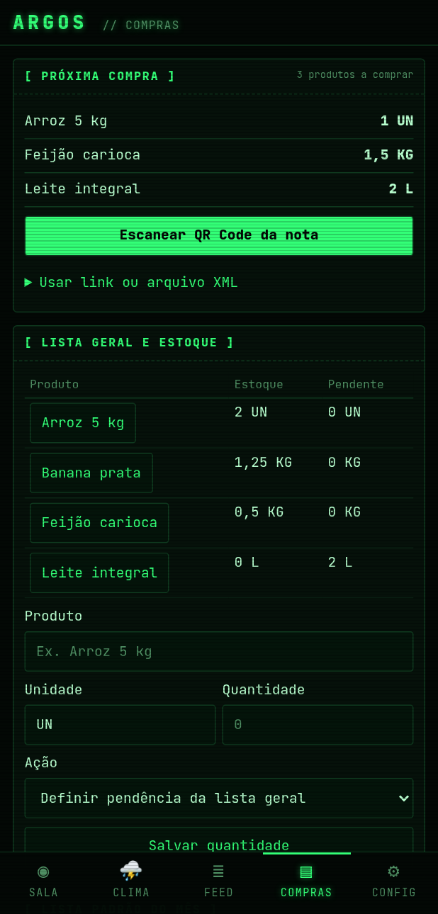
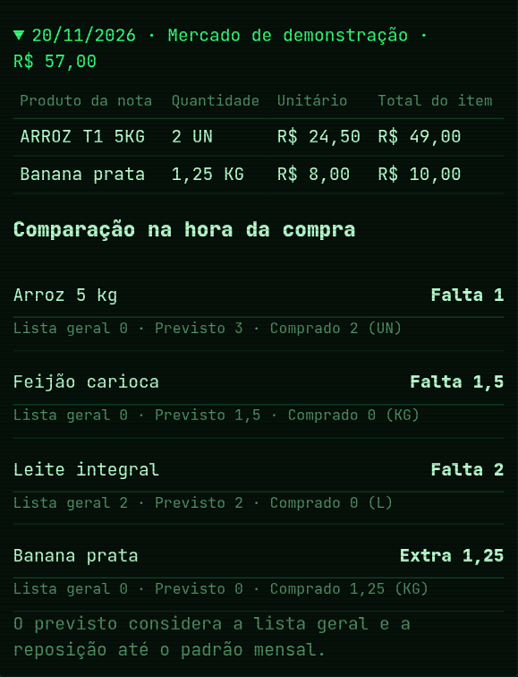

# Compras domésticas no ARGOS Android

A aba **Compras** guarda as notas e o estoque no aparelho. Abra a aba antes de ir ao mercado para ver os produtos que faltam. A consulta pelo QR Code precisa de internet. A importação de XML, o histórico, a lista e o estoque funcionam offline.

**[Baixar o APK de teste para Android](../../mobile/releases/teste-compras/argos-compras-1.2.0.apk?raw=true)** · [SHA-256](../../mobile/releases/teste-compras/argos-compras-1.2.0.apk.sha256)

O Android identifica o piloto como **ARGOS Compras (teste)**, com o pacote `br.com.vsa.argos.comprasteste`. Ele pode ser instalado ao lado do ARGOS oficial e guarda as compras em um espaço separado. A atualização oficial 1.2.0 depende da assinatura de distribuição.

## Da nota para o estoque

1. Toque em **Escanear QR Code da nota** e permita o acesso à câmera. No piloto, a consulta automática usa o portal de produção da SEFAZ-MS. Em **Usar link ou arquivo XML** você também pode colar o link ou abrir o XML de uma NFC-e modelo 65 de qualquer UF.
2. Confira o mercado, a data, o total e os produtos. Se a descrição do cupom for abreviada, escolha o produto correspondente da sua lista com a mesma unidade. O ARGOS lembra a associação em novas notas do mesmo emitente.
3. Toque em **Registrar compra e atualizar estoque**. Uma única transação salva a nota, dá entrada nos produtos e abate o que foi comprado da lista geral. A chave de 44 dígitos impede a duplicação. Uma consulta incompleta permite tentar novamente ou usar o XML.
4. Abra uma compra no **Histórico** para ver as linhas originais, quantidades, preços unitários, totais e a comparação com o que estava previsto naquele momento. O total da nota é o informado pelo documento, inclusive quando há desconto.

## Planejar o mês e a próxima compra

| Ação em Lista geral e estoque | Quando usar |
| --- | --- |
| Definir pendência da lista geral | Pedir uma quantidade para a próxima compra. Informe zero para retirar a pendência. |
| Definir quantidade padrão do mês | Escolher o saldo que deseja manter durante o mês. O padrão se repete até ser alterado. Zero retira o item do padrão. |
| Informar estoque atual | Cadastrar o saldo inicial ou corrigi-lo após contar os produtos. |
| Registrar consumo | Dar baixa no que foi usado e atualizar a sugestão de reposição. |

O ARGOS sugere a maior quantidade entre a pendência avulsa e a diferença positiva entre padrão e saldo. Por exemplo, com padrão de 3 pacotes de arroz e 1 em casa, a sugestão é de 2 pacotes. Se a lista geral já pede 2, comprar esses 2 atende aos dois objetivos. Registre um pacote de 5 kg como uma unidade de “Arroz 5 kg” quando a nota também contar pacotes. O vínculo preserva as unidades comerciais.

O catálogo e o histórico ficam em IndexedDB. A aba trata o XML e o HTML da consulta no aparelho e persiste os campos comerciais usados na tela. A desinstalação ou limpeza dos dados do app pode apagar o histórico.

## Referências de outros sistemas

| Sistema | Recurso pesquisado | Aplicação no ARGOS |
| --- | --- | --- |
| Nottei | Leitura da NFC-e, histórico por produto e comparação com o planejado. [Descrição do aplicativo](https://apps.apple.com/br/app/nottei/id6812775844) | Conferência das linhas antes da entrada e registro da comparação no histórico. |
| Grocy | Registra compras e usa níveis mínimos por produto para orientar a lista. [Recursos de estoque e compras](https://grocy.info/) | Padrão mensal por produto, saldo real, baixa de consumo e sugestão de reposição. |

O QR Code aponta para a consulta estadual. A integração de MS usa o endereço oficial, verifica a chave devolvida e confere a contagem de produtos da página. O leitor de câmera usa jsQR 1.4.0 embarcado em `mobile/www/vendor/jsqr/`. [SEFAZ-MS](https://www.sefaz.ms.gov.br/documentos-fiscais-eletronicos/nfc-e/) · [Manual do DANFE NFC-e e QR Code](https://www.nfe.fazenda.gov.br/PORTAl/exibirArquivo.aspx?AspxAutoDetectCookieSupport=1&conteudo=k%2FIuuaW4YiY%3D)

## Implantação

1. **Verificação em desenvolvimento.** Em `mobile/`, rode `npm ci`, `npm test`, `npx playwright install chromium` e `npm run test:compras`. Para usar um Chromium instalado, defina `CHROMIUM_PATH`. Os testes do navegador usam Python 3 para servir os arquivos locais e notas fictícias. O importador também foi conferido com uma consulta pública de MS de 81 itens e total de R$ 780,91.
2. **Piloto em Dourados.** No APK de teste, leia uma nota física, confira todas as linhas e o total com o cupom, vincule um item à lista, registre e tente ler a mesma nota novamente. Feche e reabra o app, registre um consumo e confira a sugestão. Experimente também a câmera sem permissão e a importação de XML no modo avião. O piloto tem armazenamento próprio. Use dados de teste.
3. **Atualização oficial.** Depois do piloto, gere a versão 1.2.0 no ambiente com o keystore original usando `bash mobile/scripts/gerar_apk.sh`. Confira o certificado e o hash, instale por cima de uma versão anterior em um aparelho de validação e então disponibilize o APK assinado. Para corrigir uma versão distribuída, entregue uma atualização com a mesma assinatura e um `versionCode` maior, preservando os dados locais. [Guia Android](ANDROID.md)
4. **Outros estados.** Para habilitar o QR de uma nova UF, confira o endereço de produção estadual e valide o formato em documentos representativos, inclusive descontos, unidades fracionadas e resposta sem itens. O XML já permite importar os itens pelo formato nacional.
