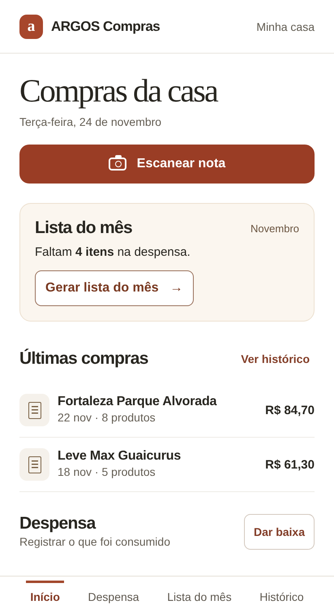

# ARGOS Compras pelo navegador

**Recomendação de 24/11/2026.** Criar **Compras da casa**, uma área web branca que abre diretamente pelo link do casal. Cada pessoa usa sua própria conta e as duas consultam o mesmo histórico, estoque e lista do mês. O proprietário também tem acesso ao painel verde do ARGOS, protegido pelo servidor. As atualizações da área de compras chegam pelo site, com a opção de adicionar um ícone à tela inicial. [Instalação de aplicativos web](https://web.dev/learn/pwa/installation/)

## Como seria abrir Compras no celular

A primeira ação é **Escanear nota**. Logo abaixo, a lista do mês indica quantos produtos faltam e permite gerar a lista. Em **Últimas compras**, cada linha mostra filial, data, quantidade de produtos e total pago. Tocar na linha abre os itens da nota. Em **Despensa**, a ação **Dar baixa** registra o consumo e atualiza a falta para a próxima compra.

*Estudo visual para celular com compras e valores fictícios.*

O público prioritário são as mulheres que vão usar a página para organizar suas compras. No primeiro teste, observar a usuária principal e, numa rodada seguinte, outras mulheres com diferentes níveis de familiaridade com o celular. Pedir que registrem uma nota no mercado, encontrem uma compra anterior e anotem em casa que o leite acabou. Verificar se conseguem concluir cada tarefa sem orientação, se os termos fazem sentido e se reconhecem quando uma compra ficou salva. Usar o retorno delas para ajustar a página.

O desenho proposto usa fundo branco, texto escuro, espaço entre as ações e terracota como sugestão para o botão principal. Manter rótulos visíveis e áreas de toque de pelo menos 44 × 44 pixels CSS nos controles principais. Após a confirmação da nota, mostrar **Compra salva** e o acesso aos itens. Se a SEFAZ demorar, mostrar **Aguardando a SEFAZ** com a ação **Tentar novamente**. Assim quem escaneou pode saber se o estoque já mudou.

## Escolha do Astro

Adotar **Astro** para gerar as páginas de Compras em HTML estático no GitHub Pages. Carregar o código da câmera quando a pessoa tocar em **Escanear nota**. Usar JavaScript também onde há interação, como dar baixa, buscar no histórico e sincronizar a lista. O serviço privado do ARGOS continua responsável por autenticar a família, guardar as compras e consultar a SEFAZ. O projeto pode reaproveitar as regras de estoque e de leitura do QR do piloto Android. [Arquitetura do Astro](https://docs.astro.build/en/concepts/islands/) · [Publicação do Astro no GitHub Pages](https://docs.astro.build/en/guides/deploy/github/)

## Onde cada parte funciona

| Parte | Proposta |
| --- | --- |
| GitHub Pages | Publicar a interface branca em `/ARGOS/compras/`, com caminhos de imagens e scripts relativos ao projeto. Reservar o painel verde e seus arquivos ao serviço autenticado do proprietário. A conta convidada abre diretamente Compras. Ao consultar este repositório, a API pública do GitHub informou `has_pages: false`. Os caminhos são endereços propostos. [Repositório](https://api.github.com/repos/viniciusandradde/ARGOS) · [Funcionamento do Pages](https://docs.github.com/en/pages/getting-started-with-github-pages/what-is-github-pages) |
| Serviço privado do ARGOS | Reaproveitar a aplicação Python, seu cadastro de usuários e a configuração de HTTPS com Caddy. Acrescentar uma área doméstica com notas, itens, movimentos de estoque, listas e cotações. Cada operação verifica a conta e a casa. A conta convidada acessa Compras. Antes de servir o painel verde, seus arquivos ou suas operações, o servidor exige a conta do proprietário, inclusive ao abrir o endereço diretamente. O servidor autentica o usuário. No Pages entram somente código e arquivos públicos. [Rotas existentes](../../src/mcp_brasil/radar/rotas.py) · [Configuração HTTPS](../../deploy/Caddyfile) · [Orientações do GitHub sobre dados sensíveis](https://docs.github.com/en/pages/getting-started-with-github-pages/github-pages-limits) |
| Os dois celulares | Cada aparelho mantém no IndexedDB a última lista sincronizada e as operações feitas sem rede. A tela informa quando há uma baixa ou nota pendente de envio. Ao reabrir ou recuperar conexão, o aplicativo sincroniza e mostra o saldo confirmado. Sem conexão, a leitura pode entrar na fila e a lista salva pode ser consultada. Hoje o piloto guarda as compras em cada aparelho. [Estoque atual](../../mobile/www/js/compras.js) · [IndexedDB](https://developer.mozilla.org/en-US/docs/Web/API/IndexedDB_API) |

Para o piloto familiar, usar o banco privado do servidor com cópia de segurança e teste de restauração. Gerar um identificador por movimento e uma restrição de unicidade por casa e chave fiscal. Assim, se os dois celulares escanearem a mesma compra, a entrada ocorre uma única vez. Se duas baixas offline ultrapassarem o saldo em conjunto, a segunda fica pendente de revisão.

O link da página pode circular e as duas pessoas podem acessá-lo sem conta no GitHub. Os dados da casa exigem uma sessão do ARGOS. O convite para Compras deve ser individual, expirar e poder ser revogado. Fazer o login no domínio da API por redirecionamento. Na implantação com Pages, usar domínio próprio para a interface e API sob o mesmo domínio-base, com sessão segura, origem explícita e proteção contra requisições indevidas. Uma alternativa, se o servidor do ARGOS já estiver acessível por HTTPS, é servir as duas páginas e a API no mesmo domínio pelo Caddy. Essa opção reduz a configuração de sessão e CORS e conserva a experiência de abrir pelo link. Confirmar domínio, hospedagem e backup antes da escolha. O custo adicional depende da infraestrutura já disponível.

## Da câmera até o estoque

1. Em **Escanear nota**, o navegador solicita a câmera traseira. HTTPS e permissão de câmera são necessários. Reaproveitar o decodificador jsQR já presente no projeto e a leitura de foto da galeria. Oferecer colar o link lido pelo Lens e importar XML. O scanner do Google usado no APK é nativo. Testar foco, iluminação e seleção de foto em Chrome/Android e Safari/iPhone. O piloto começa com QR de NFC-e de Mato Grosso do Sul e identifica outros tipos de código. [Leitor atual](../../mobile/www/js/compras-ui.js) · [Câmera no navegador](https://developer.mozilla.org/en-US/docs/Web/API/MediaDevices/getUserMedia)
2. Ao ler, guardar o QR e mostrar **Código lido · consultando SEFAZ-MS**. O serviço privado valida o estado, o documento e o destino oficial antes de consultar. Aplicar prazo de resposta e conferir chave, itens e total. Isso resolve a restrição de leitura entre sites imposta pelo navegador. A disponibilidade do portal e a autorização da nota continuam dependendo da SEFAZ. [Consulta oficial](https://www.sefaz.ms.gov.br/documentos-fiscais-eletronicos/nfc-e/) · [CORS no navegador](https://developer.mozilla.org/en-US/docs/Web/HTTP/Guides/CORS)
3. Na emissão em contingência, guardar a consulta pendente, com hora da tentativa, **Tentar novamente** e **Abrir na SEFAZ**. Se o portal pedir verificação visual, a pessoa a conclui no portal oficial. Importar o XML fornecido pelo estabelecimento também permite conferir os produtos. Leitura pendente não altera o estoque. Após conferir os itens, uma única transação registra a nota e dá entrada nos produtos. [Regra de contingência de MS](https://aacpdappls.net.ms.gov.br/appls/legislacao/serc/legato.nsf/34248fea4d6a6d2a04256b210079ce20/3b1a17dab0089e030425805e003af50e)
4. **Dar baixa** fica na linha do produto. **Buscar nas notas** filtra por produto, mercado e data. Ao tocar em **Gerar lista do mês**, qualquer um dos dois recebe a mesma lista. A falta de cada item é a maior quantidade entre zero, a pendência avulsa e o padrão mensal menos o saldo. Com padrão de seis litros, saldo de dois e nenhuma pendência avulsa, entram quatro litros para comprar.

## Como a cotação chegaria aos dois

Manter o **Fortaleza Parque Alvorada** (Rua Cláudio Goelzer, 1620) e o **Leve Max Guaicurus** (Av. Guaicurus, 500) lado a lado. A consulta pública da loja virtual do Leve Max exibiu a Guaicurus como filial de retirada e apresentou produtos com preços. O Abevê também exibiu retirada na Albino Torraca. Validar cobertura e atualização recorrente antes de integrar esses canais e identificar o preço como **retirada on-line**. [Leve Max](https://www.levemaxsuperatacado.com.br/ofertas) · [Abevê](https://www.abeve.com.br/ofertas)

O site do Fortaleza identifica a filial e divulga o calendário de ofertas. O Clube F+ solicita identificação. A pesquisa não confirmou uma tabela pública recorrente de preços por produto para essa unidade. Começar por encartes oficiais datados que incluam a filial e preços conferidos com origem e validade. Na ausência de preço elegível, mostrar **Sem cotação**. O último valor pago na nota aparece à parte, com sua data. Exibir também Abevê, Atacadão e Comper como opções adicionais. A diferença da cesta inteira só aparece quando as duas filiais têm cotação para todos os itens e quantidades, nas condições de clube ou atacado que a família pode usar. [Fortaleza](https://supermercadofortalezams.com.br/) · [Plano de comparação por filial](PROPOSTA-COMPRA-DO-MES.md)

## Ordem de implantação e critério de entrega

| Etapa | Entrega verificável |
| --- | --- |
| 1. Compras compartilhadas | Abrir o link em dois celulares com contas diferentes. Uma pessoa registra uma compra e a outra vê o estoque, dá baixa e gera a lista. Abrir diretamente o endereço do painel e de sua API em sessão anônima ou com a conta de Compras. Só a conta do proprietário pode receber a interface verde e os dados do painel. |
| 2. Notas e migração | Testar nota autorizada, contingência, indisponibilidade, XML, duas leituras da mesma nota e retomada sem rede. Se houver dados no APK, disponibilizar exportação e importação conferidas por chave. Comparar quantidade de notas e saldos antes da troca. A página web não consegue ler diretamente o banco privado do aplicativo. |
| 3. Preços e painel completo | Medir a cobertura de 20 produtos nas filiais preferidas, validar validade e canal contra a fonte e mostrar cotações incompletas. Disponibilizar os módulos do painel verde na entrada privada do proprietário. O vigia nativo atual usa o agendador do Android. Para alertas com o navegador fechado, executar o trabalho periódico no servidor e avaliar notificações web nos aparelhos da família. [Vigia atual](../../mobile/www/runners/vigia.js) · [Suporte à sincronização em segundo plano](https://developer.mozilla.org/en-US/docs/Web/API/Background_Synchronization_API) |

O primeiro marco de uso é o estoque compartilhado comprovado em dois celulares. A troca para uso diário deve ocorrer depois de validar a recuperação de uma nota pendente e a importação dos dados existentes.
